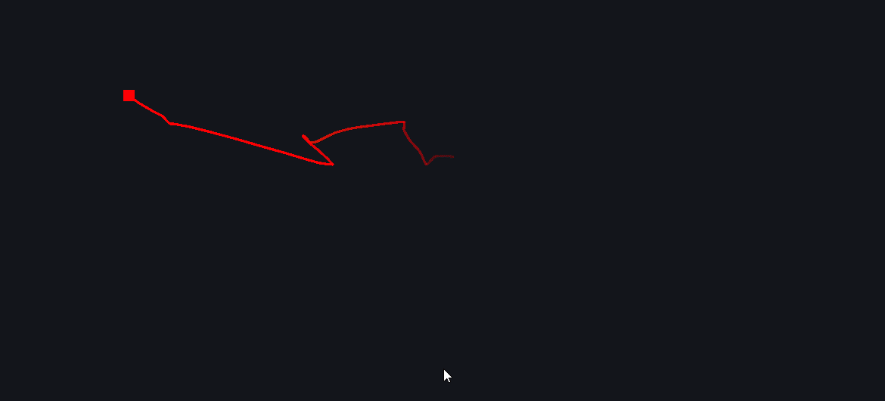

# OBS Dynamic Mouse Trail Source

[](https://github.com/Juansero29/obs-mouse-trail-source/actions/workflows/release.yml)

A custom OBS Studio input source plugin that renders a smooth, fading mouse trail.

Official prebuilt release artifacts are currently Windows x64 only.



## Video Demos

[](https://youtu.be/rg75-mgQCg0)

[](https://youtu.be/LNiuHOJXUm4)

## Quick Install (No Build Tools)

> ⚠️ Always run OBS as administrator to ensure the plugin works correctly

You do not need to build from source to use this plugin on Windows x64.

1. Open the repo Releases page on GitHub.
2. Download the latest `mouse-trail-windows-x64-<version>.zip`.
3. Close OBS completely.
4. Extract the ZIP into your OBS install root.
   - Example: `C:\Program Files\obs-studio`
5. Start OBS **ALWAYS RUN AS ADMINISTRATOR** and add source -> **Dynamic Mouse Trail**.

The release ZIP is already laid out with the folders OBS expects:

- `obs-plugins/64bit/mouse_trail.dll`
- `data/obs-plugins/mouse_trail/locale/en-US.ini`
- `bin/64bit/*.dll` (required MinGW runtime DLLs)

macOS and Linux currently require building from source.

## Maintainer Release Flow (Tags)

This repository includes an automated release workflow at `.github/workflows/release.yml`.

1. Update version if needed.
2. Commit and push to main.
3. Create and push a version tag:

```powershell
git tag v1.0.0
git push origin v1.0.0
```

4. GitHub Actions will build, package, and publish a GitHub Release automatically.

## Features

- **Smooth Mouse Trail Rendering**: Dynamic trail that follows your cursor with configurable appearance
- **Multiple Trail Behavior Modes**:
  - **Smoke Mode**: Older trail points drift upward (anti-gravity effect) for an eye-catching, floating appearance
  - **Precision Mode**: Trail fades in-place without drift, ideal for accurate cursor tracking
- **Trail Persistence Modes**:
  - **Timed Fade**: Trail points gradually fade out over a configurable duration (0.1 to 10 seconds)
  - **Forever**: Trail points persist indefinitely on the canvas (no cleanup)
  - **Laser Mode**: No trail, only shows a single dot at cursor position for minimal visual footprint
- **Configurable Trail Appearance**:
  - Trail base color (any RGB color via color picker)
  - Trail thickness (1-40 pixels)
  - Dot size (1-40 pixels)
  - Tail end opacity (transparency at trail end, 0-1)
  - Tail opacity falloff curve (0.2-3.0 power curve for fade shape)
- **Custom Cursor Sprite**: Load your own PNG image as the cursor dot with a one-click clear button
- **Canvas Mapping Modes**: Map trail coordinates to different screen configurations:
  - **All Monitors**: Trail spans all connected monitors as a virtual desktop
  - **Specific Monitor**: Trail limited to a single selected monitor
  - **Mousepad Simulation**: Trail based on physical mousepad dimensions and mouse DPI (Windows only)
- **Boundary Behaviors**: Control trail edge behavior:
  - **Delimited Zone**: Trail clamped at canvas edges (stops movement at boundary)
  - **Infinite Wrap**: Trail wraps to opposite side when crossing boundary
  - **Infinite Recenter**: Trail jumps back toward center when reaching boundary
- **Advanced Mousepad Mode** (Windows):
  - Auto-detect mouse DPI from Windows pointer speed or manually override
  - Real-time effective DPI display
  - Physical mousepad dimensions (width/height in millimeters)
  - Raw Windows input sensor integration for precise pixel-level tracking
- **Thread-Safe Architecture**: Safe concurrent access to trail data
- **Frame-Rate Independent Updates**: Uses OBS `video_tick` delta time for smooth behavior at any FPS
- **Multi-Monitor Support**: Full monitor enumeration and selection
- **Platform Scope**: Official release binaries for Windows x64; macOS/Linux are source-build best effort with fallback behavior

## Repository Layout

- `src/plugin-main.c`: OBS module entry points
- `src/trail-source.cpp`: source callbacks (`create`, `video_tick`, `video_render`)
- `src/trail-manager.hpp`: thread-safe trail data structure + physics
- `data/locale/en-US.ini`: locale file for the plugin data path
- `CMakeLists.txt`: standalone MinGW build + OBS deployment copy steps
- `.env`: local build/deploy settings (OBS path and optional overrides)
- `scripts/build_and_deploy.py`: cross-platform build + deploy script
- `scripts/build_and_deploy.ps1`: Windows PowerShell wrapper
- `scripts/build_and_deploy.cmd`: Windows Command Prompt wrapper
- `scripts/build_and_deploy.sh`: macOS/Linux shell wrapper

## Cross-Platform Build And Deploy (.env + Script)

This repository includes a single Python script that runs on Windows, macOS, and Linux:

- `scripts/build_and_deploy.py`

It does three things:

1. Configures CMake with your `.env` values
2. Builds the plugin
3. Copies the plugin and locale files into your OBS installation

### 1) Configure `.env`

Edit `.env` and set at least:

- `OBS_ROOT`: root of your OBS installation

Examples:

- Windows: `OBS_ROOT=D:/Programs/OBS28/obs-studio`
- Linux: `OBS_ROOT=/usr`
- macOS: `OBS_ROOT=/Applications/OBS.app`

Optional settings in `.env`:

- `BUILD_DIR` (default: `build`)
- `CMAKE_BUILD_TYPE` (default: `Release`)
- `CMAKE_GENERATOR` and `CMAKE_BUILD_CONFIG`
- `OBS_HEADERS_DIR`, `OBS_CONFIG_DIR`, `OBS_LIB_PATH`
- `MINGW_BIN` (Windows runtime DLL copy source)

### 2) Run The Script

Install script UI dependency first:

```powershell
python -m pip install rich
```

From repo root:

```powershell
python scripts/build_and_deploy.py
```

On macOS/Linux you can also use:

```bash
python3 scripts/build_and_deploy.py
```

Or use the wrappers:

```powershell
./scripts/build_and_deploy.ps1
```

```bat
scripts\build_and_deploy.cmd
```

```bash
bash scripts/build_and_deploy.sh
```

The build launcher now provides:

- Colored status messages (info/success/error)
- Live loading/progress bars for each major build/deploy step
- Clear error summaries with the last command output lines

### 3) Restart OBS And Test

1. Close OBS before running the script (to avoid file locks)
2. Run the script
3. Start OBS and add **Dynamic Mouse Trail**
4. Test **Trail Mode** and **Trail Color** in source properties

## Source Properties Guide

### Trail Group

#### Trail Behavior Mode
- **Smoke**: Older trail points drift upward (anti-gravity effect). Creates a floating, eye-catching appearance.
- **Precision**: Trail points fade in place without drift. Better for precise, static cursor tracking.

#### Trail Base Color
Set the color of the trail gradient. Trail points fade from this color to transparent over time (or based on position).

#### Trail Persistence
Controls how trail points are managed:
- **Timed Fade**: Points persist for the configured duration (see "Visible Trail History") then fade out
- **Forever**: Points never fade; they persist indefinitely on the canvas
- **No Trail (Laser Dot Only)**: Only the current cursor position dot is rendered; no trail history

#### Visible Trail History (seconds)
Only visible when "Timed Fade" persistence is selected. Duration in seconds that trail points remain visible before fading out. Range: 0.1 to 10 seconds.

#### Trail Thickness
Width of the trail line segments in pixels. Range: 1 to 40 pixels.

#### Dot Size
Size of the cursor dot (or sprite) in pixels. Range: 1 to 40 pixels.

#### Dot Image (PNG)
Optional custom PNG image to use as the cursor sprite instead of the default solid dot. Click the folder icon to browse and select a PNG file. Click **"Clear Custom Dot"** to reset to the default solid dot.

#### Tail End Opacity
Transparency of the oldest part of the trail (the tail). Range: 0.0 (fully transparent) to 1.0 (fully opaque). Creates a fade effect from head (opaque) to tail.

#### Tail Opacity Falloff
Curve shape for the fade from head to tail. Range: 0.2 to 3.0.
- Lower values: sharp, quick fade to transparent
- Higher values: gradual, stretched fade
- 1.0: linear fade

### Canvas Group

#### Canvas Source Mode
Defines the coordinate system and rendering area for the trail:
- **All Monitors (Virtual Desktop)**: Trail spans across all connected monitors. Trail can move across monitor boundaries seamlessly. Default mode.
- **Specific Monitor Only**: Trail is constrained to a single monitor. After selecting this option, use the **"Target Monitor"** dropdown to choose which monitor.
- **Mousepad Simulation**: Trail movement is based on physical mouse movement relative to your mousepad dimensions and DPI. See mousepad settings below.

#### Target Monitor
Only visible when "Specific Monitor Only" is selected. Dropdown showing available monitors with their resolution and position. Format: `DISPLAY1 (1920x1080 @ 0,0)`

### Mousepad Group

These settings are only visible when **Canvas Source Mode** is set to "Mousepad Simulation".

#### Mouse DPI (dots per inch)
Sensitivity of your mouse measured in DPI. This value is used to convert on-screen pixel movement into physical mousepad movement.
- Default: 800 DPI (common value)
- Typical range: 400-3200 DPI
- Manual override: Check **"Set Manually"** to enter a custom value
- Auto-detect: Uncheck **"Set Manually"** to use Windows system pointer speed (Windows only)

#### Set Manually (Override System DPI Estimate)
- **Checked (default)**: Use the manual DPI value entered in **"Mouse DPI"**. Precision-focused mode.
- **Unchecked**: Estimate DPI from Windows pointer speed. Uses system settings to calculate DPI.

#### Effective DPI
Read-only display showing the currently active DPI value (either manual or system estimate). Updates in real-time when you toggle the manual checkbox or adjust the manual DPI slider.

#### Pad Width (mm)
Physical width of your mousepad in millimeters. Used to calculate the canvas width for trail rendering.
- Default: 250mm
- Example: A standard mousepad is typically 250-350mm wide

#### Pad Height (mm)
Physical height of your mousepad in millimeters. Used to calculate the canvas height for trail rendering.
- Default: 250mm
- Example: A standard mousepad is typically 200-300mm tall

#### Raw Input Active (Sensor Deltas)
Read-only checkbox (Windows only). Shows whether the plugin is successfully using Windows raw input for precise sensor-level mouse deltas.
- **Checked**: Raw input is active; using direct hardware sensor data for maximum precision
- **Unchecked**: Falling back to cursor position approximation (less precise but more compatible)

### Boundary Group

#### Boundary Strategy
Controls what happens when the trail reaches the edge of the canvas:

- **Delimited Zone (Clamped at Edge)**: Trail movement stops at the canvas boundary. Moving the cursor beyond the boundary does not cause trail movement beyond the edge. Useful for contained effects.

- **Infinite Zone (Wrap to Opposite Side)**: When trail movement crosses an edge, it wraps around to the opposite side. Creates a continuous, torus-like wrapping effect. Useful for infinite canvas effects.

- **Infinite Zone (Restart from Center)**: When trail movement crosses an edge, the trail position jumps back toward the center and continues. Creates a "teleport" or "reset" effect at boundaries. Useful for cycling effects.

## Prerequisites (Windows, MinGW path)

This section is only required if you want to build or modify the plugin.

1. OBS Studio installed
2. CMake 3.16+
3. Ninja
4. Strawberry Perl MinGW toolchain (`gcc`, `g++`, `gendef`, `dlltool`)

## One-Time Setup

This lightweight build links against your installed OBS and a local copy of OBS headers.

1. Create dependency folders:

```powershell
mkdir .deps\lib -Force
mkdir .deps\tmp -Force
```

2. Download OBS source headers (version should match your installed OBS as closely as possible):

```powershell
Invoke-WebRequest -Uri "https://github.com/obsproject/obs-studio/archive/refs/tags/33.0.0.zip" -OutFile .deps\obs-studio.zip
Expand-Archive -Path .deps\obs-studio.zip -DestinationPath .deps
Rename-Item .deps\obs-studio-33.0.0 .deps\obs-studio-src
```

3. Generate MinGW import library from your installed `obs.dll`:

```powershell
Copy-Item "C:\Program Files\obs-studio\bin\64bit\obs.dll" .deps\tmp\obs.dll -Force
Push-Location .deps\tmp
gendef obs.dll
dlltool -d obs.def -l ..\lib\libobs.dll.a --dllname obs.dll
Pop-Location
```

4. Ensure `obsconfig.h` exists at:

- `.deps/obs-studio-src/build_x64/config/obsconfig.h`

If it is missing, copy it from an existing OBS source build tree or generate it with an OBS CMake configure.

## Build

1. Set your OBS installation root (adjust path if needed):

```powershell
cmake -S . -B build -G Ninja -DOBS_ROOT="D:/Programs/OBS28/obs-studio"
```

2. Build:

```powershell
cmake --build build
```

On successful build, CMake post-build steps will copy:

- `mouse_trail.dll` -> `<OBS_ROOT>/obs-plugins/64bit/`
- locale file -> `<OBS_ROOT>/data/obs-plugins/mouse_trail/locale/`
- MinGW runtime DLLs -> `<OBS_ROOT>/bin/64bit/`

## Install / Verify in OBS

1. Close OBS before copying/rebuilding (to avoid file lock errors).
2. Launch OBS.
3. Add source -> **Dynamic Mouse Trail**.
4. Move your mouse and verify the trail appears.
5. Open the source properties to set **Trail Mode** and **Trail Color**.

If the source does not appear, check:

```powershell
$log = Get-ChildItem "$env:APPDATA\obs-studio\logs" -Filter "*.txt" | Sort-Object LastWriteTime -Descending | Select-Object -First 1
Select-String -Path $log.FullName -Pattern "mouse_trail|Failed to initialize module|obs_register_source"
```

## Contributing

Contributions are welcome.

1. Fork the repo and create a feature branch.
2. Keep changes focused and include a short rationale in the PR description.
3. Verify:
   - project builds with your configured `OBS_ROOT`
   - source appears in OBS Add Source menu
   - trail renders without regressions
4. Run formatting/linting tools you normally use for C/C++ before opening a PR.

### Suggested PR Checklist

- [ ] Builds successfully
- [ ] OBS loads `mouse_trail.dll`
- [ ] Source registration succeeds (no `obs_register_source failed`)
- [ ] Visual behavior tested in OBS preview
- [ ] README updated if setup or behavior changed

## Platform Support

### Windows (Primary)
- ✅ Full support for all features
- Monitor enumeration via `EnumDisplayMonitors`
- Cursor position via `GetCursorPos`
- Multi-monitor support with individual monitor selection
- Windows raw input for precision mousepad mode
- Official GitHub release artifacts are published for Windows x64

### macOS/Linux
- ⚠️ Source-build support only (no official release binaries yet)
- Mousepad mode uses approximation (not raw input)
- Monitor selection shows single fallback monitor
- Contributions welcome for platform-specific implementations

### Known Limitations
- **Mousepad mode**: Currently only implemented on Windows. macOS/Linux use screen-space approximation.
- **Monitor enumeration**: Platform-specific. Windows is fully featured.
- **Boundary behaviors**: All modes (wrap, recenter, delimited) work consistently across platforms.

## Supported Languages

The plugin UI is available in multiple languages. OBS will automatically display the plugin in your system language if available:

- 🇬🇧 **English** (en-US) - Default
- 🇫🇷 **French** (fr-FR)
- 🇪🇸 **Spanish** (es-ES)
- 🇩🇪 **German** (de-DE)

To change the plugin language, change your OBS UI language in Settings → General → Language.

## Troubleshooting

### Source doesn't appear in OBS
Check the OBS log:
```powershell
$log = Get-ChildItem "$env:APPDATA\obs-studio\logs" -Filter "*.txt" | Sort-Object LastWriteTime -Descending | Select-Object -First 1
Select-String -Path $log.FullName -Pattern "mouse_trail|Failed to initialize module"
```

### Trail not visible or frozen
1. Ensure **Trail Mode** and **Trail Color** are set in source properties
2. Move your mouse in the OBS preview area to trigger trail updates
3. Check that the selected canvas mode is appropriate for your setup

### Monitor selection shows empty list
This typically means the monitor enumeration encountered an issue. Try:
1. Use **All Monitors** mode as default
2. Restart OBS
3. Check the OBS log for monitor enumeration errors

## License

This project is licensed under GPLv2-or-later. See `LICENSE`.
